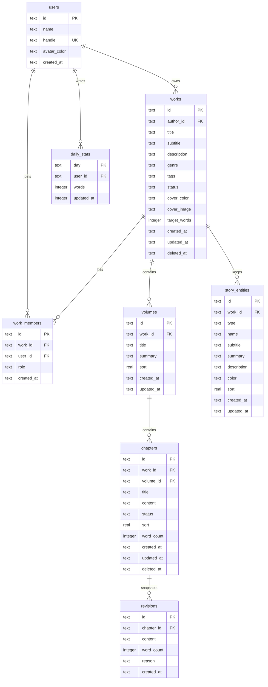

# 墨坞 Inkdock · 数据模型

版本：0.2  
更新：2026-10-23  
数据库：SQLite 3（`data/inkdock.db`，WAL，`user_version = 2`）

---

## 1. ER 图（M1）



M2 起追加：`comments`、`ai_sessions`、`invites`。

---

## 2. 表定义

### 2.1 users

| 列 | 类型 | 约束 | 说明 |
| --- | --- | --- | --- |
| id | TEXT | PK | M1 固定 `local-user` |
| name | TEXT | NOT NULL | 笔名，显示于工作台与预览 |
| handle | TEXT | NOT NULL UNIQUE | 账号标识 |
| avatar_color | TEXT | NOT NULL | 头像平涂色（十六进制） |
| created_at | TEXT | NOT NULL | ISO 8601 UTC |

### 2.2 works

| 列 | 类型 | 约束 | 说明 |
| --- | --- | --- | --- |
| id | TEXT | PK | UUID |
| author_id | TEXT | FK users(id) | 所有者 |
| title | TEXT | NOT NULL | 1–60 字 |
| subtitle | TEXT | NOT NULL DEFAULT '' | 副标题 |
| description | TEXT | NOT NULL DEFAULT '' | 简介，≤ 1000 字 |
| genre | TEXT | NOT NULL DEFAULT '其他' | 题材 |
| tags | TEXT | NOT NULL DEFAULT '[]' | JSON 数组，M2 使用 |
| status | TEXT | CHECK | serializing / completed / paused |
| cover_color | TEXT | NOT NULL | 封面平涂色 |
| cover_image | TEXT | NULL | 书封 data URL（JPEG/PNG/WebP）；≤1,100,000 字符且解码 ≤700,000 字节 |
| target_words | INTEGER | ≥ 0 | 目标字数，0 表示未设置 |
| created_at | TEXT | NOT NULL | ISO UTC |
| updated_at | TEXT | NOT NULL | 最近编辑（含章节保存） |
| deleted_at | TEXT | NULL | 软删除时间 |

索引：`works(author_id, updated_at DESC)`、`works(status)`。

### 2.3 work_members

为 M2 预留，M1 为作品所有者写入一条 owner 记录。

| 列 | 类型 | 约束 |
| --- | --- | --- |
| id | TEXT | PK |
| work_id | TEXT | FK works(id) ON DELETE CASCADE |
| user_id | TEXT | FK users(id) |
| role | TEXT | owner / editor / commenter / reader |
| created_at | TEXT | NOT NULL |

唯一约束：`(work_id, user_id)`。

### 2.4 volumes

| 列 | 类型 | 约束 |
| --- | --- | --- |
| id | TEXT | PK |
| work_id | TEXT | FK works(id) ON DELETE CASCADE |
| title | TEXT | NOT NULL，1–60 |
| summary | TEXT | NOT NULL DEFAULT '' |
| sort | REAL | NOT NULL，卷顺序 |
| created_at / updated_at | TEXT | NOT NULL |

索引：`volumes(work_id, sort)`。

### 2.5 chapters

| 列 | 类型 | 约束 |
| --- | --- | --- |
| id | TEXT | PK |
| work_id | TEXT | FK works(id) ON DELETE CASCADE |
| volume_id | TEXT | FK volumes(id) ON DELETE CASCADE |
| title | TEXT | NOT NULL，≤ 120 |
| content | TEXT | NOT NULL DEFAULT ''，≤ 2 MB |
| status | TEXT | draft / ready / published |
| sort | REAL | NOT NULL，卷内顺序 |
| word_count | INTEGER | NOT NULL DEFAULT 0 |
| created_at / updated_at | TEXT | NOT NULL |
| deleted_at | TEXT | NULL |

索引：

- `chapters(volume_id, sort)`
- `chapters(work_id, deleted_at)`
- `chapters(updated_at DESC)`

### 2.6 revisions

| 列 | 类型 | 约束 |
| --- | --- | --- |
| id | TEXT | PK |
| chapter_id | TEXT | FK chapters(id) ON DELETE CASCADE |
| content | TEXT | NOT NULL |
| word_count | INTEGER | NOT NULL |
| reason | TEXT | auto / manual / before_restore |
| created_at | TEXT | NOT NULL |

索引：`revisions(chapter_id, created_at DESC)`。

### 2.7 daily_stats

| 列 | 类型 | 约束 |
| --- | --- | --- |
| day | TEXT | `YYYY-MM-DD`（本地时区） |
| user_id | TEXT | FK users(id) |
| words | INTEGER | 当日新增字数，非负 |
| updated_at | TEXT | NOT NULL |

主键：`(day, user_id)`。

统计口径：每次保存取 `max(0, 新字数 - 旧字数)` 累加。删改导致字数下降不回冲，作为「产出」的近似值；界面标注「今日新增」。

### 2.8 story_entities

| 列 | 类型 | 约束 |
| --- | --- | --- |
| id | TEXT | PK |
| work_id | TEXT | FK works(id) ON DELETE CASCADE |
| type | TEXT | CHECK：character / organization / location / item / concept |
| name | TEXT | NOT NULL，1–60 |
| subtitle | TEXT | NOT NULL DEFAULT ''，≤80 |
| summary | TEXT | NOT NULL DEFAULT ''，≤300 |
| description | TEXT | NOT NULL DEFAULT ''，≤6000 |
| color | TEXT | NOT NULL，`#RRGGBB` |
| sort | REAL | NOT NULL，列表顺序 |
| created_at / updated_at | TEXT | NOT NULL |

索引：`story_entities(work_id, type, sort)`。

说明：

- 一条设定只属于一本书；创作一个作品时可独立记录角色、组织、地点、物品与概念。
- 与章节、卷、版本没有外键关系；设定是写作参考，不进入正文、预览或导出。
- 删除为硬删除；不更新作品 `updated_at`，避免查看或整理设定被误判为正文编辑。
- 类型与识别色调色板集中在 `src/lib/constants.ts`；服务端仍校验类型枚举与颜色格式。

---

## 3. 不变量

1. 删除作品是软删除；列表查询过滤 `deleted_at IS NULL`。
2. 章节软删除后不计入字数、卷计数，不出现在预览/导出中。
3. 卷只能在其章节数（未删除）为 0 时删除；删除卷会级联清除该卷内已软删除的章节及其版本。M1 没有回收站界面，这些章节本就不可见；M2 上线回收站前需重新评估该行为。
4. 章节的 `volume_id` 必须属于同一 `work_id`；写入时校验。
5. 每本书至少有一个卷（创建时自动建立「第一卷」）。
6. 新建章节的 `sort` 为卷内最大值 + 1000，留出中点插入空间。
7. 章节保存与作品 `updated_at`、`daily_stats` 在同一事务内完成。
8. 版本快照不可修改；恢复版本会先快照当前正文。
9. 字数由服务端重算，不信任客户端上报。
10. `works.cover_image` 只接受带正确文件头的 JPEG / PNG / WebP data URL；省略字段保留原值，`null` 清空。
11. 故事设定必须归属于未归档作品；类型必须在五类枚举内，名称必填，长度与颜色在服务端再次校验。
12. 删除设定是硬删除，且不得改动作品 `updated_at`、章节正文、版本或每日字数。
13. 设定不参与导出与预览查询；任何把设定混入正文的实现都视为破坏数据边界。

---

## 4. 字数口径

实现：`src/lib/words.ts`

```
CJK 统一表意文字：每个字符 1
拉丁字母/数字连续串：每串 1
空白、标点、符号：不计
```

段落数：按空行或换行分割，去除纯空白段。

服务端保存时使用同一函数，避免客户端与服务端口径漂移。

---

## 5. 时间与排序

- 所有时间为 ISO 8601 UTC 字符串；日期统计使用服务端本地日期 `YYYY-MM-DD`。
- 排序使用 REAL，允许 `(prev+next)/2` 插入，精度不足时重排整卷。
- M1 只支持追加与按 sort 渲染，拖拽排序在 M1.5 实现。

---

## 6. 迁移策略

- `PRAGMA user_version` 记录版本；M1 schema 为 `1`，书封与设定增量为 `2`。
- 启动时在 `lib/db.ts` 中按版本顺序执行幂等迁移（建表使用 `IF NOT EXISTS`）。
- v1 → v2：为 `works` 补 `cover_image` 列（先查 `PRAGMA table_info`），创建 `story_entities` 及其索引；已有数据不受影响。
- 结构变化必须同步更新本文档与 `05-context-handoff.md`。
- 破坏性迁移先备份 `data/inkdock.db` 为 `.bak`。
- M1 数据库仅本机；跨机迁移通过导出 TXT/Markdown，M2 提供 JSON 全量导出。

---

## 7. 容量估算

| 对象 | 规模假设 | 单条约 | 总体 |
| --- | --- | --- | --- |
| 作品 | 100 | 500 B | 50 KB |
| 卷 | 600 | 200 B | 120 KB |
| 章节 | 30,000 | 3 KB（含正文均值） | 90 MB |
| 版本 | 10,000 | 3 KB | 30 MB |
| 书封 | 100 | ≤700 KB | ≤70 MB |
| 设定 | 5,000 | 1 KB | 5 MB |
| 合计 | | | < 300 MB |

SQLite 单文件完全可承载；WAL 文件在检查点后回落。

---

## 8. 未来表（设计预留）

| 表 | 里程碑 | 用途 |
| --- | --- | --- |
| story_entity_links | M2 | 设定与章节/段落双向链接、时间线与伏笔视图 |
| comments | M3 | 章节位置锚定批注与回复 |
| edit_events | M3 | 章节级操作日志（谁、何时、增删多少字） |
| invites | M2 | 作品邀请码与角色 |
| ai_sessions | M2 | 提示、上下文摘要、输出、采用状态 |
| user_prefs | M2 | 跨设备偏好（编辑字体、目标） |
| backups | M2 | 手动/自动备份记录 |
