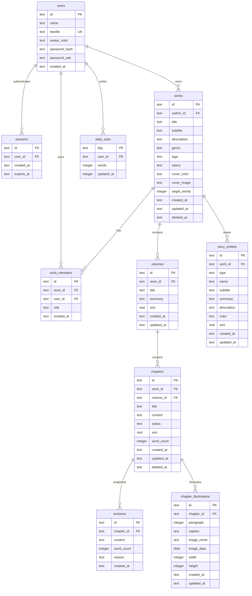

# 墨坞 Inkdock · 数据模型

版本：0.4  
更新：2026-10-23  
数据库：SQLite 3（`data/inkdock.db`，WAL，`user_version = 4`）

---

## 1. ER 图（当前）



后续追加：`comments`、`edit_events`、`ai_sessions`；邀请码在跨设备协作阶段再评估。

---

## 2. 表定义

### 2.1 users

| 列 | 类型 | 约束 | 说明 |
| --- | --- | --- | --- |
| id | TEXT | PK | UUID；M0 演示账号曾使用固定 `local-user` |
| name | TEXT | NOT NULL | 笔名，显示于工作台与预览；1–24 字 |
| handle | TEXT | NOT NULL UNIQUE | 账号标识，3–24 位小写字母/数字/下划线 |
| avatar_color | TEXT | NOT NULL | 头像平涂色，取自 `AVATAR_COLORS` |
| password_hash | TEXT | NOT NULL DEFAULT '' | scrypt 64 字节哈希（hex）；演示账号为空 |
| password_salt | TEXT | NOT NULL DEFAULT '' | 每账号 16 字节随机盐（hex）；演示账号为空 |
| created_at | TEXT | NOT NULL | ISO 8601 UTC |

说明：本机账号没有邮箱、找回密码或第三方登录；已登录时可在设置页改密。演示账号 `local-user` 无密码；首个真实账号注册时，其作品、成员关系与统计迁移到新账号，随后删除演示账号。

### 2.1.1 sessions

| 列 | 类型 | 约束 | 说明 |
| --- | --- | --- | --- |
| id | TEXT | PK | 令牌的 SHA-256 哈希（hex），不存原始令牌 |
| user_id | TEXT | FK users(id) ON DELETE CASCADE | 会话所属账号 |
| created_at | TEXT | NOT NULL | ISO UTC |
| expires_at | TEXT | NOT NULL | 创建后 30 天 |

索引：`sessions(user_id)`、`sessions(expires_at)`。创建新会话时顺带删除已过期行；登出删除当前会话。原始令牌只存在浏览器 httpOnly cookie `ink_session` 中。

改密时更新 `users.password_hash` / `password_salt`，并在同一事务内删除该 `user_id` 除当前会话外的所有行。因此旧密码无法再登录，其他浏览器持有的令牌立即失效；当前浏览器保持登录，无需重新输入新密码。会话表结构不因改密变化。

### 2.2 works

| 列 | 类型 | 约束 | 说明 |
| --- | --- | --- | --- |
| id | TEXT | PK | UUID |
| author_id | TEXT | FK users(id) | 所有者 |
| title | TEXT | NOT NULL | 1–60 字 |
| subtitle | TEXT | NOT NULL DEFAULT '' | 副标题 |
| description | TEXT | NOT NULL DEFAULT '' | 简介，≤ 1000 字 |
| genre | TEXT | NOT NULL DEFAULT '其他' | 题材 |
| tags | TEXT | NOT NULL DEFAULT '[]' | JSON 数组，M2 使用 |
| status | TEXT | CHECK | serializing / completed / paused |
| cover_color | TEXT | NOT NULL | 封面平涂色 |
| cover_image | TEXT | NULL | 书封 data URL（JPEG/PNG/WebP）；≤1,100,000 字符且解码 ≤700,000 字节 |
| target_words | INTEGER | ≥ 0 | 目标字数，0 表示未设置 |
| created_at | TEXT | NOT NULL | ISO UTC |
| updated_at | TEXT | NOT NULL | 最近编辑（含章节保存） |
| deleted_at | TEXT | NULL | 软删除时间 |

索引：`works(author_id, updated_at DESC)`、`works(status)`。

### 2.3 work_members

作品访问边界。每个作品至少有一条作者 owner 记录；M1 迁移会为既有作品补齐 owner。

| 列 | 类型 | 约束 |
| --- | --- | --- |
| id | TEXT | PK |
| work_id | TEXT | FK works(id) ON DELETE CASCADE |
| user_id | TEXT | FK users(id) |
| role | TEXT | CHECK：owner / editor / commenter / reader |
| created_at | TEXT | NOT NULL |

唯一约束：`(work_id, user_id)`。角色等级：owner 3 > editor 2 > commenter 1 > reader 0。author 的 owner 记录不可修改或删除；移除成员立即失去访问。`commenter` 目前没有批注写入路径，行为等同只读，等待 M2 批注功能。

### 2.4 volumes

| 列 | 类型 | 约束 |
| --- | --- | --- |
| id | TEXT | PK |
| work_id | TEXT | FK works(id) ON DELETE CASCADE |
| title | TEXT | NOT NULL，1–60 |
| summary | TEXT | NOT NULL DEFAULT '' |
| sort | REAL | NOT NULL，卷顺序 |
| created_at / updated_at | TEXT | NOT NULL |

索引：`volumes(work_id, sort)`。

### 2.5 chapters

| 列 | 类型 | 约束 |
| --- | --- | --- |
| id | TEXT | PK |
| work_id | TEXT | FK works(id) ON DELETE CASCADE |
| volume_id | TEXT | FK volumes(id) ON DELETE CASCADE |
| title | TEXT | NOT NULL，≤ 120 |
| content | TEXT | NOT NULL DEFAULT ''，≤ 2 MB |
| status | TEXT | draft / ready / published |
| sort | REAL | NOT NULL，卷内顺序 |
| word_count | INTEGER | NOT NULL DEFAULT 0 |
| created_at / updated_at | TEXT | NOT NULL |
| deleted_at | TEXT | NULL |

索引：

- `chapters(volume_id, sort)`
- `chapters(work_id, deleted_at)`
- `chapters(updated_at DESC)`

### 2.6 revisions

| 列 | 类型 | 约束 |
| --- | --- | --- |
| id | TEXT | PK |
| chapter_id | TEXT | FK chapters(id) ON DELETE CASCADE |
| content | TEXT | NOT NULL |
| word_count | INTEGER | NOT NULL |
| reason | TEXT | auto / manual / before_restore |
| created_at | TEXT | NOT NULL |

索引：`revisions(chapter_id, created_at DESC)`。

### 2.7 daily_stats

| 列 | 类型 | 约束 |
| --- | --- | --- |
| day | TEXT | `YYYY-MM-DD`（本地时区） |
| user_id | TEXT | FK users(id) |
| words | INTEGER | 当日新增字数，非负 |
| updated_at | TEXT | NOT NULL |

主键：`(day, user_id)`。

统计口径：每次保存取 `max(0, 新字数 - 旧字数)` 累加。删改导致字数下降不回冲，作为「产出」的近似值；界面标注「今日新增」。

### 2.8 story_entities

| 列 | 类型 | 约束 |
| --- | --- | --- |
| id | TEXT | PK |
| work_id | TEXT | FK works(id) ON DELETE CASCADE |
| type | TEXT | CHECK：character / organization / location / item / concept |
| name | TEXT | NOT NULL，1–60 |
| subtitle | TEXT | NOT NULL DEFAULT ''，≤80 |
| summary | TEXT | NOT NULL DEFAULT ''，≤300 |
| description | TEXT | NOT NULL DEFAULT ''，≤6000 |
| color | TEXT | NOT NULL，`#RRGGBB` |
| sort | REAL | NOT NULL，列表顺序 |
| created_at / updated_at | TEXT | NOT NULL |

索引：`story_entities(work_id, type, sort)`。

说明：

- 一条设定只属于一本书；创作一个作品时可独立记录角色、组织、地点、物品与概念。
- 与章节、卷、版本没有外键关系；设定是写作参考，不进入正文、预览、TXT / Markdown 与网页导出，只有整书 JSON 备份包含。
- 删除为硬删除；不更新作品 `updated_at`，避免查看或整理设定被误判为正文编辑。
- 类型与识别色调色板集中在 `src/lib/constants.ts`；服务端仍校验类型枚举与颜色格式。

### 2.9 chapter_illustrations

| 列 | 类型 | 约束 |
| --- | --- | --- |
| id | TEXT | PK |
| chapter_id | TEXT | FK chapters(id) ON DELETE CASCADE |
| paragraph | INTEGER | NOT NULL DEFAULT 0，0–10000；0 表示正文之前 |
| caption | TEXT | NOT NULL DEFAULT ''，≤120 |
| image_mime | TEXT | CHECK：jpeg / png / webp |
| image_data | BLOB | NOT NULL；解码后 ≤1,150,000 字节 |
| width | INTEGER | NOT NULL，1–10000，压缩后宽度 |
| height | INTEGER | NOT NULL，1–10000，压缩后高度，与宽度保持比例 |
| created_at / updated_at | TEXT | NOT NULL |

索引：`chapter_illustrations(chapter_id, paragraph, created_at)`。

说明：

- 插画按「段落锚点」定位，不写入 `chapters.content`：`paragraph = N` 表示渲染在第 N 段之后，`0` 表示标题与第一段之间。正文编辑器与阅读器用同一个 `paragraphList` 口径数段落。
- 二进制存 BLOB，列表查询只返回元数据与图片 URL；图片由 `/api/illustrations/[id]/image` 单独返回，避免把 base64 塞进 RSC 载荷。
- 新建时 `image_mime` 由 data URL 声明与文件头共同决定，二者不一致即拒绝；客户端先压到最长边 1400、WebP 质量递减，失败时退回 JPEG 白底，最终 data URL 目标 ≤1,400,000 字符。
- 同一章节可以有多张插画指向同一锚点，按 `created_at` 升序渲染。
- 编辑只允许改段落锚点与说明文字；更换图片需删除后重新插入，避免版本与缓存语义复杂化。
- 删除为硬删除，并级联清除章节删除时的插画；删除章节的插画不会出现在任何读取或导出路径。

---

## 3. 不变量

1. 删除作品是软删除；列表查询过滤 `deleted_at IS NULL`。
2. 章节软删除后不计入字数、卷计数，不出现在预览/导出中。
3. 卷只能在其章节数（未删除）为 0 时删除；删除卷会级联清除该卷内已软删除的章节及其版本。M1 没有回收站界面，这些章节本就不可见；M2 上线回收站前需重新评估该行为。
4. 章节的 `volume_id` 必须属于同一 `work_id`；写入时校验。
5. 每本书至少有一个卷（创建时自动建立「第一卷」）。
6. 新建章节的 `sort` 为卷内最大值 + 1000，留出中点插入空间。
7. 章节保存与作品 `updated_at`、`daily_stats` 在同一事务内完成。
8. 版本快照不可修改；恢复版本会先快照当前正文。
9. 字数由服务端重算，不信任客户端上报。
10. `works.cover_image` 只接受带正确文件头的 JPEG / PNG / WebP data URL；省略字段保留原值，`null` 清空。
11. 故事设定必须归属于未归档作品；类型必须在五类枚举内，名称必填，长度与颜色在服务端再次校验。
12. 删除设定是硬删除，且不得改动作品 `updated_at`、章节正文、版本或每日字数。
13. 设定不参与预览、TXT / Markdown 与网页 HTML 导出；只有整书 JSON 备份包含设定。任何把设定混入正文或网页的实现都视为破坏数据边界。
14. 插画必须归属于未删除章节；章节所属作品必须未归档，否则写入与图片读取均拒绝。
15. 插画锚点是段落序号，不是字符偏移；读取时钳制到当前段落数，正文改写不会让图片落到非法位置。
16. 插画 CRUD 不改动章节与作品 `updated_at`，不创建版本快照，不计入 `daily_stats`；它不参与自动保存的乐观锁。
17. 插画图片只接受带正确文件头的 JPEG / PNG / WebP，服务端限制 data URL 字符数与解码字节数；不接受 SVG、GIF、远程 URL。
18. 插画是展示层内容：不进入 TXT / Markdown，但网页 HTML 导出会内嵌图片，整书 JSON 会保存 base64；插画不改变字数、段落数与阅读进度口径。
19. 删除插画为硬删除；软删除章节或归档作品后，其插画接口返回 404，不泄露内容。
20. `users.handle` 唯一且规范化为小写；密码只存 scrypt 哈希与盐，任何接口都不返回密码字段或密码哈希。
21. 会话原始令牌只存在客户端 cookie；数据库 `sessions.id` 为其 SHA-256 哈希。过期会话不可认证，登出立即删除。
22. 作品访问必须同时满足：作品未归档，且当前账号在 `work_members` 中；无成员关系返回 404。
23. 写操作最低角色：作品资料/卷章/设定/插画/自动保存为 editor；成员管理/归档为 owner。读与导出为任意成员。
24. 每个作品必须保留作者 owner；所有者角色不可改、不可移除。邀请对象必须已注册，不能重复加入。
25. 移除成员只删除 `work_members` 行，不改动作品、章节与版本；对方未提交的本地草稿不会写回。
26. 整书导入必须新建作品与新的 UUID；不得复用或覆盖既有作品 ID，不得把 owner 设为导入者以外的账号。
27. 整书导入在单事务内写入作品、owner、卷、章、插画与设定；任何一条校验或写入失败都整体回滚。
28. 改密必须同时更新哈希与盐，并删除该账号除当前会话外的所有会话；不得保留能继续使用旧密码的凭据。
29. 网页导出是只读派生数据：不写数据库、不改变 `updated_at`、不创建版本；文本必须转义，图片只允许 data URI，不得包含脚本或外部资源。
30. 网页导出不包含设定、成员、版本或统计；它不是整书备份，不能用于导入。

---

## 4. 字数口径

实现：`src/lib/words.ts`

```
CJK 统一表意文字：每个字符 1
拉丁字母/数字连续串：每串 1
空白、标点、符号：不计
```

段落数：按空行或换行分割，去除纯空白段。

服务端保存时使用同一函数，避免客户端与服务端口径漂移。

---

## 5. 时间与排序

- 所有时间为 ISO 8601 UTC 字符串；日期统计使用服务端本地日期 `YYYY-MM-DD`。
- 排序使用 REAL，允许 `(prev+next)/2` 插入，精度不足时重排整卷。
- M1 只支持追加与按 sort 渲染，拖拽排序在 M1.5 实现。
- 整书导入时卷/章/设定顺序按归档顺序重新分配 `sort`，不信任归档中的数值。

---

## 6. 迁移策略

- `PRAGMA user_version` 记录版本；M1 schema 为 `1`，书封与设定增量为 `2`，章节插画为 `3`，账号、会话与成员为 `4`。
- 启动时在 `lib/db.ts` 中按版本顺序执行幂等迁移（建表使用 `IF NOT EXISTS`）。
- v1 → v2：为 `works` 补 `cover_image` 列（先查 `PRAGMA table_info`），创建 `story_entities` 及其索引；已有数据不受影响。
- v2 → v3：创建 `chapter_illustrations` 及其索引；插画与正文分离，迁移不触碰 `chapters.content`。已有章节、版本、设定与统计保留。
- v3 → v4：为 `users` 补 `password_hash` / `password_salt`（空字符串默认值），创建 `sessions` 与索引；为每个既有作品补齐 author 的 owner 成员。已有作品、章节、设定、插画与统计保留。
- 首个真实账号注册时执行一次数据接管：把 `local-user` 的作品 `author_id`、成员关系与 `daily_stats` 转给新账号，再删除 `local-user`。该操作在事务中完成，只发生在 `users` 表为空时。
- 结构变化必须同步更新本文档与 `05-context-handoff.md`。
- 破坏性迁移先备份 `data/inkdock.db` 为 `.bak`。
- 跨机迁移通过整书 JSON；TXT / Markdown 只适合投稿与纯文字阅读；HTML 网页是带封面与插画的阅读副本，三者都不承担双向同步。

---

## 7. 容量估算

| 对象 | 规模假设 | 单条约 | 总体 |
| --- | --- | --- | --- |
| 作品 | 100 | 500 B | 50 KB |
| 卷 | 600 | 200 B | 120 KB |
| 章节 | 30,000 | 3 KB（含正文均值） | 90 MB |
| 版本 | 10,000 | 3 KB | 30 MB |
| 书封 | 100 | ≤700 KB | ≤70 MB |
| 插画 | 300 | ≤1.15 MB | ≤345 MB |
| 设定 | 5,000 | 1 KB | 5 MB |
| 账号 | 20 | 300 B | 6 KB |
| 会话 | 100 | 150 B | 15 KB |
| 合计 | | | < 700 MB |

SQLite 单文件完全可承载；WAL 文件在检查点后回落。整书导出会临时在内存中生成 base64 JSON，带插画的书可能达到数十 MB；导入上限 120 MB 字符，超过后应拆分。网页导出同样在内存中拼接完整 HTML，输出体量约等于正文加所有内嵌图片，生成时不写库。

---

## 8. 未来表（设计预留）

| 表 | 里程碑 | 用途 |
| --- | --- | --- |
| story_entity_links | M2 | 设定与章节/段落双向链接、时间线与伏笔视图 |
| comments | M2 | 章节位置锚定批注与回复；commenter 角色开始有写入路径 |
| edit_events | M3 | 章节级操作日志（谁、何时、增删多少字） |
| invites | M5 | 跨设备邀请码与链接邀请 |
| ai_sessions | M2 | 提示、上下文摘要、输出、采用状态 |
| user_prefs | M2 | 跨设备偏好（编辑字体、目标） |
| backups | M2 | 手动/自动备份记录 |
| password_resets | M5 | 邮箱或管理员重置令牌；本机阶段不提供找回 |
